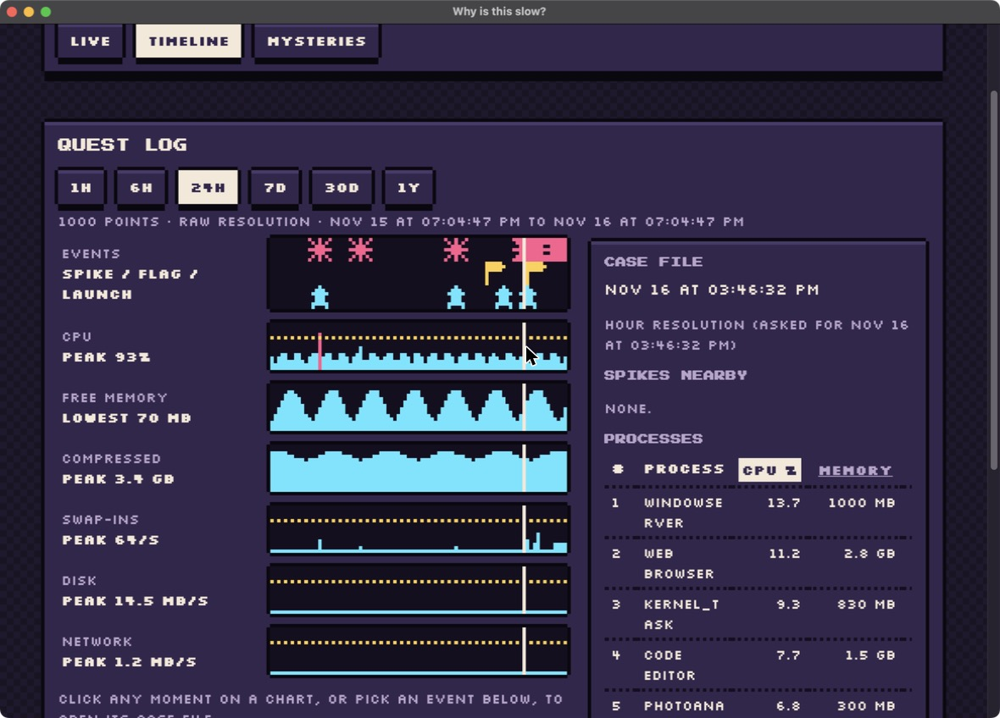
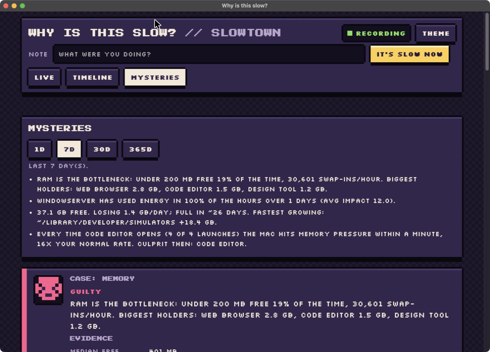

# Why is this slow?

[](https://github.com/aishik-sinha/why-is-this-slow/actions/workflows/tests.yml)


A small macOS tool that watches your machine and tells you what was really going on when it slowed down.

It records CPU, memory pressure, disk and network activity, plus each app's CPU, memory and energy use, every 5 seconds. A local dashboard lines up each spike with the apps that were running at that moment, and works out longer-running mysteries: which app has been draining the battery for months, which app chokes the machine every time it opens, and what is filling the disk.

No installs: Python 3 and the commands built into macOS (`top`, `ps`, `ioreg`, `netstat`, `du`). No npm, and no build step unless you want the optional Mac app. The only external request is the pixel font, loaded from Google Fonts.


| Timeline | Mysteries |
|---|---|
|  |  |

The screenshots use invented demo data, not a real machine's history.

## Usage

```bash
python3 slow.py install            # record in the background from login on
python3 slow.py uninstall          # stop the background recorder; data is kept
python3 slow.py record             # or: record in this terminal only; Ctrl+C to stop
python3 slow.py mark "chrome froze" # run the moment it feels slow
python3 slow.py why 30             # text report on the last 30 minutes
```

While it is recording, the dashboard is at <http://127.0.0.1:8765>.

`install` copies the code to `~/Library/Application Support/why-is-this-slow/app/` and registers a launchd agent, so re-run it after `git pull`.

## Mac app

```bash
./build_app.sh install   # builds "Why is this slow?.app" and copies it to ~/Applications
```

Then open **Why is this slow?** from `~/Applications` (not from `build/`: there macOS would ask for access to your Desktop). The app shows the dashboard in its own window and records while it is open. The menu bar shows free memory, with **It's Slow Now** one click away.

- Needs Apple's Command Line Tools (`xcode-select --install`) and runs the recorder with their `/usr/bin/python3`.
- Closing the window keeps recording in the menu bar. Quit stops it.
- **Start at Login** is in the menu-bar menu. Use it or `slow.py install`, not both; the app is the simpler choice. If both run, the launchd recorder records and the app only shows it. If macOS refuses the toggle, add the app by hand in System Settings > General > Login Items.
- Rebuild after `git pull`. macOS may then ask again for permissions it had granted, and for the login item.
- Built for this Mac only: signed ad hoc, not notarized, Apple silicon.

## Dashboard

This branch has the isometric pixel-game look: your Mac as a small town, where buildings are the busiest processes, the tank is memory pressure and the belts are disk and network traffic. This iteration uses bigger, crunchier pixels: a low-resolution scene snapped to a limited palette, dark outlines, a dithered sky, and chunkier interface borders.

- **Live**: the last 10 minutes of CPU, free and compressed memory, swap-ins, disk and network, with the top processes and the apps holding the most memory.
- **Timeline**: 1 hour to 1 year. Spikes, your marks and app launches sit on a shared time axis. Click any moment to see what was running.
- **Mysteries**: plain-language verdicts with the evidence behind them: memory pressure, battery drains, apps that choke the machine on launch, disk filling up, and what was happening at each moment you marked.
- **It's slow now**: saves a mark from the page, the same as `slow.py mark`.

## Data

History is stored in `~/Library/Application Support/why-is-this-slow/slow.db` (override with the `SLOW_DB` environment variable). It is not in this folder because a background process may not read `~/Desktop`, `~/Documents` or `~/Downloads`. An old `slow.db` next to the script is moved there automatically.

Per-sample rows are kept for 7 days. Older history is kept forever as hourly summaries, so the database settles at roughly 100 MB.

## Security

The dashboard listens on `127.0.0.1` only and has no login: anything running as you can already read the database. It rejects requests whose `Host` is not local (DNS rebinding), sends no CORS headers, and only accepts marks as same-origin JSON, so a web page in your browser cannot read your process list or write to it.

## Tests

```bash
python3 -m unittest   # also checks the app bundle, once built
mac/smoke.sh          # after ./build_app.sh: the app starts the recorder, and a crashed app leaves none behind
```

## Limits

- App names are cut to 16 characters by `top`.
- Spike thresholds (top of `slow.py`) and insight thresholds (top of `insights.py`) are starting guesses; tune them for your machine.
- Battery drains only count processes in `top`'s ten busiest by CPU each sample, so a low-CPU, high-energy process can be under-counted.
- Launch detection only covers `.app` bundles in the Applications folders.
- Folder growth only scans `~/Library/Caches`, `Application Support`, `Developer` and `Logs`. Desktop, Documents, Downloads and app containers are skipped because they trigger macOS privacy prompts, so Docker images and Downloads growth will not show up.
- Not recorded: GPU use and heat throttling (macOS only shows them to admin users), battery percentage, per-process network and disk activity, which app is frontmost.
- No notifications, no settings file, macOS only.
- Not yet verified on a real install: how long the folder scan takes, and whether it triggers privacy prompts when run by launchd.

## License

[MIT](LICENSE)
